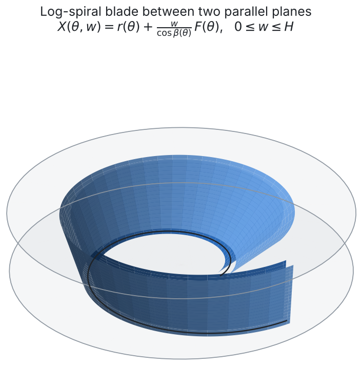
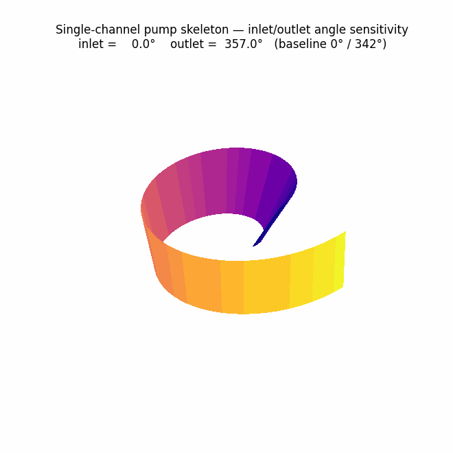
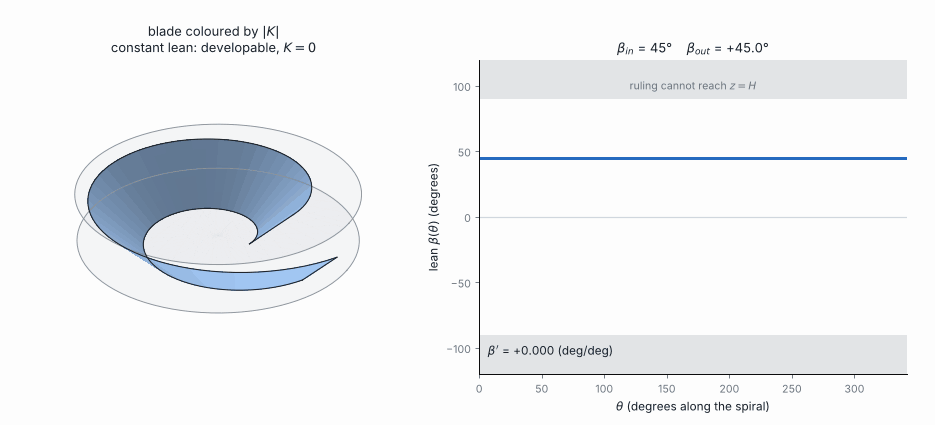

# Single-Channel Pump Skeleton: A Log-Spiral, Twisted-Ribbon Construction

**Author:** Panagiotis Zavitsanos
**Status:** geometric skeleton complete; fluid-dynamic characterization not yet performed (see [Limitations](#9-limitations-and-future-work))

<p align="center">
  
</p>

## Abstract

This repository documents the derivation and computational implementation of a parametric surface
intended as the geometric skeleton of a single-channel pump: a spiral channel of finite wall
thickness, swept along a logarithmic-spiral base curve with a controllable cross-sectional twist.
The construction generalizes the classical Möbius strip's rotating-fiber idea — normally a uniform
half-twist applied around a circle — to a twist applied around a logarithmic spiral, producing an
open (non-closed) ribbon whose start angle ("inlet"), end angle ("outlet"), and twist law are all
free design parameters. The derivation proceeded through five iterations, worked out symbolically and
implemented in Mathematica, and is reproduced here in Python together with two animations: one
showing the surface's sensitivity to small perturbations of the inlet and outlet angles, and one
showing the effect of sweeping the twist law itself from no twist to a full 180° half-twist.

## Table of contents

1. [Motivation](#1-motivation)
2. [Development progression](#2-development-progression)
3. [Mathematical formulation](#3-mathematical-formulation)
4. [Generalized control function](#4-generalized-control-function)
5. [Inlet/outlet angle parametrization](#5-inletoutlet-angle-parametrization)
6. [Animations](#6-animations)
7. [Repository structure](#7-repository-structure)
8. [Reproducing the results](#8-reproducing-the-results)
9. [Limitations and future work](#9-limitations-and-future-work)

## 1. Motivation

A single-channel pump moves fluid through one continuous spiral passage rather than through several
blade-separated channels, as in a conventional multi-vane impeller. Before any fluid-dynamic design
can begin, that passage needs a well-defined geometric skeleton: a surface that sweeps from an inlet
opening to an outlet opening along a continuously curving path, with a controllable cross-section,
wall thickness, and twist. This project develops that skeleton from first principles in differential
geometry, rather than starting from a CAD primitive, so that every design parameter (spiral growth
rate, twist law, wall thickness, inlet angle, outlet angle) is traceable to an explicit formula.

## 2. Development progression

The construction was developed iteratively across five Mathematica notebooks. Each notebook is kept
in [`notebooks/`](notebooks/), numbered in the order below.

| Step | Notebook | Date | Contribution |
|---|---|---|---|
| 1 | [`01_homotopy_example.nb`](notebooks/01_homotopy_example.nb) | 2025-11-19 | Establishes the basic tool used throughout: a homotopy `H(s,t) = (1-t) f0(s) + t f1(s)` between two 3D curves, animated with a parameter slider. This is the warm-up exercise that motivates thinking of a family of curves as a continuously deformable surface. |
| 2 | [`02_mobius_animations.nb`](notebooks/02_mobius_animations.nb) | 2025-11-22 | Builds the classical Möbius strip, `(1 + w cos(θ/2)) (cos θ, sin θ, · ) , w sin(θ/2)`, and animates the rotating cross-sectional fiber to make the half-twist mechanism visible: at each angle θ, the fiber direction is a rotation of the radial vector `R(θ)` and the vertical axis `Z` by `θ/2`. |
| 3 | [`03_log_spiral_v1.nb`](notebooks/03_log_spiral_v1.nb) | 2025-11-24 | Replaces the circle with a logarithmic spiral `r(θ) = a e^{bθ}(cos θ, sin θ)` and derives its Frenet frame (tangent `T(θ)`, normal `N(θ)`) symbolically. The rotating-fiber idea from Step 2 is reapplied using `N(θ)` in place of the circle's radial vector, producing the first spiral ribbon surface `X(θ, w)`. |
| 4 | [`04_modified_mobius_curvature.nb`](notebooks/04_modified_mobius_curvature.nb) | 2025-12-01 | A parallel branch on the *circular* Möbius strip (not the spiral): adds a warping term `α v² sin(u)` to introduce non-zero Gaussian curvature, and confirms the curvature formula analytically. This established that the flat ribbon construction can be deliberately curved — a fact used qualitatively in later design discussion, though the curvature term itself was not carried into the spiral channel. |
| 5 | [`05_log_spiral_v2_final.nb`](notebooks/05_log_spiral_v2_final.nb) | 2026-01-08 | The final Mathematica iteration and the basis of this repository. Revises Step 3's twist law to a slower, partial rotation `β(θ) = π/4 − θ/8` (rather than a full `θ/2` half-twist), rescales the offset so the channel width stays consistent as the twist angle varies, and — new in this step — gives the ribbon finite wall thickness by offsetting along its own surface normal, then samples and exports the resulting point cloud to CSV for CAD (Autodesk Inventor) import. [`data/spiral_3D_points.xlsx`](data/spiral_3D_points.xlsx) is that exported point cloud. |
| 6 | [`src/channel_model.py`](src/channel_model.py) (this repository) | 2026-07 | Reimplements Step 5 in Python/SymPy and **generalizes the twist law** `β(θ)` from the fixed formula `π/4 − θ/8` into an explicit, tunable control function (see [§4](#4-generalized-control-function)), so the total amount of twist across the channel is itself a design parameter rather than baked into the spiral formula. |

Steps 1–3, 5, and 6 form a single connected line of development (homotopy → rotating fiber → spiral
generalization → finite-thickness channel with tunable sweep → tunable twist law). Step 4 is a side
investigation into intrinsic curvature that informed the design conceptually but is architecturally
independent of the final channel surface.

## 3. Mathematical formulation

All symbols below are implemented symbolically in [`src/channel_model.py`](src/channel_model.py),
mirroring the derivation in Step 5.

**Base curve.** A logarithmic spiral in the plane,

```
r(θ) = a e^{bθ} (cos θ, sin θ),        a = 0.2, b = 0.2
```

**Frenet frame.** The unit tangent and (principal) unit normal, obtained by differentiation and
normalization:

```
T(θ) = r'(θ) / |r'(θ)|
N(θ) = T'(θ) / |T'(θ)|
```

**Twist law (Step 5, as built in Mathematica).** A partial-twist angle, much slower than the
classical Möbius strip's `θ/2`:

```
β(θ) = π/4 − θ/8
```

**Fiber direction.** A unit vector blending the in-plane normal (lifted to 3D with a zero
z-component, written `N̂`) with the vertical axis `Ẑ = (0,0,1)`:

```
F(θ) = −sin(β(θ)) N̂(θ) + cos(β(θ)) Ẑ
```

**Channel mid-surface (Step 5).** The spiral, lifted to 3D (`r̂`, zero z-component), swept along
`F(θ)` and offset by the cross-channel coordinate `w`:

```
X(θ, w) = r̂(θ) + (w / cos β(θ)) F(θ)
```

**Wall thickness.** The surface normal `n(θ, w) = (X_θ × X_w)/|X_θ × X_w|` gives two finite-thickness
shells at offset `t = ±h/2`:

```
X_thick(θ, w, t) = X(θ, w) + t · n(θ, w),      h = 0.05
```

The channel cross-section spans `w ∈ [−0.1, 0.1]` in the visualizations in this repository (the
original CAD export in Step 5 instead used the one-sided range `w ∈ [0, 0.3]`, which produces the
same surface shape, just parametrized from one edge rather than the centerline).

## 4. Generalized control function

`β(θ) = π/4 − θ/8` is a fixed law: its slope (`−1/8`) and offset (`π/4`) are hard-coded together, so
for the Step 5 domain `θ ∈ [0°, 342°]` it happens to produce a twist that drifts from 45° down to
about 2° — there is no direct way to ask for a specific total twist, e.g. "sweep the twist from 0° to
180° across the channel."

This repository factors that out into an explicit **control function** with two independent, named
parameters — a fixed sweep domain `θ_max` and a target total twist `β_max`:

```
β(θ; θ_max, β_max) = β_max · θ / θ_max
```

so that `β(0) = 0` and `β(θ_max) = β_max` by construction, for *any* `θ_max` and *any* `β_max` —
in particular `β_max = π` (180°), a full half-twist end-to-end, the same total twist the classical
Möbius strip applies over a full `2π` turn, but here applied over the shorter, open spiral sweep.

**A note on a hidden singularity.** Step 5's offset term `w / cos β(θ)` was written to keep the
channel's apparent width constant as `β` drifts near 45°. That factor diverges at `β = 90°`, which is
now inside the requested `0° → 180°` range. `control_function_surface()` in
[`src/channel_model.py`](src/channel_model.py) therefore drops the `1/cos β` correction and offsets by
plain `w · F(θ)` instead — `F` is always a unit vector, so this stays well-defined at every `β`,
including exactly 90°, at the cost of the channel's XY-projected width narrowing near `β = 90°`
(geometrically honest behavior for a rotating offset, rather than an artifact of the correction term).
This is a deliberate, documented deviation from Step 5's exact formula, used only for the control-
function exploration in [§6.2](#62-control-function-sweep); the original `channel_surface()` /
`channel_shell()` functions (Step 5's exact formula, singularity and all) are unchanged and still used
for the hero image and the inlet/outlet animation.

## 5. Inlet/outlet angle parametrization

`θ` sweeps the channel from `θ_inlet` to `θ_outlet`. In Step 5's final render these were `0°` and
`342°` (`1.9π` rad) respectively — just short of a full turn, leaving a visible gap between the
channel's two open ends. Because the spiral and twist law are defined for all `θ`, these two bounds
can be moved independently to widen, narrow, rotate, or reposition the channel opening without
touching the underlying surface formula.

## 6. Animations

### 6.1 Inlet/outlet sensitivity

[`scripts/make_animation.py`](scripts/make_animation.py) renders
[`media/inlet_outlet_sweep.gif`](media/inlet_outlet_sweep.gif), which perturbs the inlet and outlet
angles by small, independent, out-of-phase sinusoids around the baseline (±12° on the inlet, ±15° on
the outlet), holding Step 5's twist law fixed, and recomputes the full surface at each frame. The
surface is colored by θ (a proxy for position along the flow path). The on-screen title reports the
exact inlet/outlet angle for the current frame.

<p align="center">
  
</p>

### 6.2 Control-function sweep

[`scripts/make_control_function_animation.py`](scripts/make_control_function_animation.py) renders
[`media/control_function_sweep.gif`](media/control_function_sweep.gif). This animation holds `θ`
fixed at the baseline domain `[0°, 342°]` — it does **not** move the inlet/outlet — and instead
sweeps the control function's target twist `β_max` smoothly from 0° up to 180° and back down. Two
panels are shown side by side every frame: the 3D channel surface on the left, and a plot of the
control function `β(θ)` itself (the straight line from `(0, 0)` to `(θ_max, β_max)`) on the right, so
the line's slope and the surface's twist change in lockstep.

<p align="center">
  
</p>

At `β_max = 0°` the channel is a flat, untwisted offset band. At `β_max = 180°` it carries a full
Möbius-style half-twist from inlet to outlet.

[`scripts/render_hero.py`](scripts/render_hero.py) renders the static, finite-thickness banner image
at the top of this document, at the baseline inlet/outlet angles and Step 5's twist law.

## 7. Repository structure

```
.
├── README.md
├── LICENSE
├── requirements.txt
├── notebooks/            original Mathematica notebooks, in development order
├── src/
│   └── channel_model.py      SymPy/NumPy re-implementation + generalized control function
├── scripts/
│   ├── render_hero.py                     static banner render (finite thickness)
│   ├── make_animation.py                  inlet/outlet angle-sensitivity animation
│   └── make_control_function_animation.py control-function (twist law) sweep animation
├── data/
│   └── spiral_3D_points.xlsx original CAD-export point cloud from Step 5
└── media/
    ├── hero_channel.png
    ├── inlet_outlet_sweep.gif
    └── control_function_sweep.gif
```

## 8. Reproducing the results

```bash
python -m venv .venv && source .venv/bin/activate   # optional
pip install -r requirements.txt

python src/channel_model.py                       # sanity-check the geometry (prints grid ranges)
python scripts/render_hero.py                      # -> media/hero_channel.png
python scripts/make_animation.py                   # -> media/inlet_outlet_sweep.gif
python scripts/make_control_function_animation.py  # -> media/control_function_sweep.gif
```

To explore a different inlet/outlet angle by hand:

```python
from src.channel_model import channel_surface

x, y, z, theta, w = channel_surface(theta_min_deg=-10, theta_max_deg=330)
```

To explore a different total twist (control function) by hand:

```python
from src.channel_model import control_function_surface

x, y, z, theta, w = control_function_surface(theta_max_deg=342, beta_max_deg=180)
```

## 9. Limitations and future work

This repository establishes the **geometric skeleton only**. No fluid-mechanical modeling — flow
rate, head, velocity/pressure field, Reynolds number, cavitation margin, or any CFD analysis — has
been performed on this surface. The wall-thickness offset and CAD export in Step 5 are the only steps
taken toward a manufacturable part; the "pump" framing describes the intended end use of the
geometry, not a validated pump design.

Natural next steps:

- Fluid-dynamic simulation (e.g. CFD) over the channel interior to characterize flow behavior.
- A structured sweep over spiral parameters `(a, b)`, not just the twist law and inlet/outlet angle.
- Reconciling `channel_surface()` (Step 5's exact `1/cos β` formula) and `control_function_surface()`
  (the singularity-free generalization in §4) into a single surface function, e.g. by capping or
  regularizing `1/cos β` instead of dropping it outright.
- Solid-model export (STEP/STL) directly from `channel_model.py` rather than via the CSV point-cloud
  round trip used in Step 5.
- Reconciling the two `w` conventions (centered `[-0.1, 0.1]` vs. one-sided `[0, 0.3]`) into a single
  parametrization.

## License

MIT — see [`LICENSE`](LICENSE).
