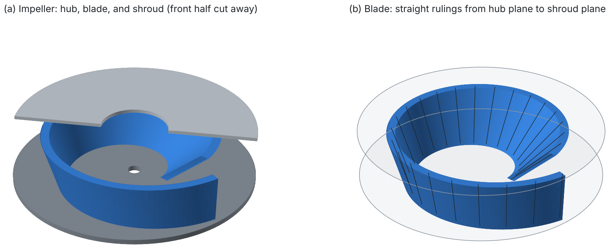
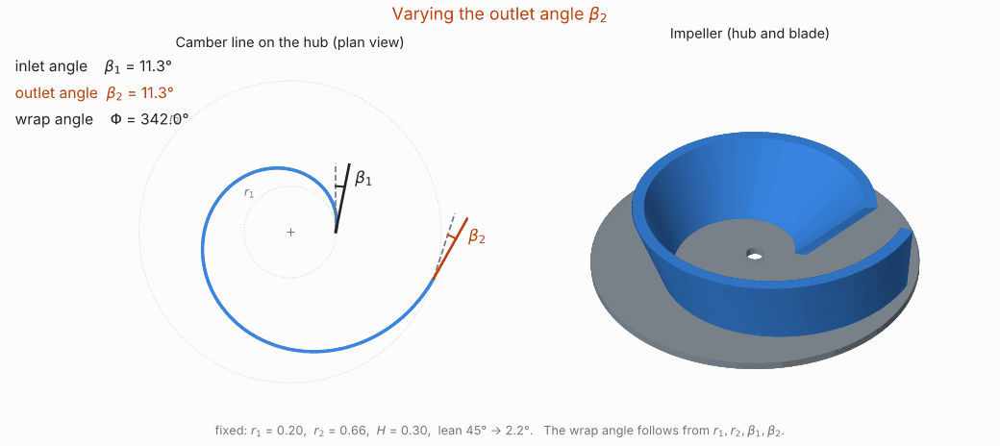
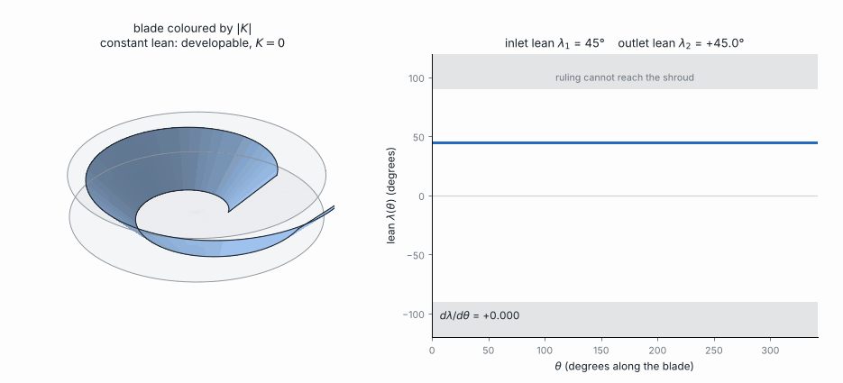

# Single-Blade Impeller: Inlet and Outlet Angles in the Language of Curvature

**Author:** Panagiotis Zavitsanos  
**Status:** geometry complete and verified; no flow analysis yet (see [Limitations](#9-limitations-and-next-steps))

<p align="center">
  
</p>

## Overview

A single-blade (single-channel) pump impeller has one long blade, wrapped once around the axis between a hub disc and a shroud disc. Its designer works with a short list of numbers, above all the **blade angle at the inlet, $\beta_1$, and at the outlet, $\beta_2$**.

This repository builds such a blade so that those numbers are the inputs, and everything else follows in closed form from the differential geometry of curves and ruled surfaces:

1. **The camber line is defined by its blade angle.** Prescribing $\beta_1$ at radius $r_1$ and $\beta_2$ at radius $r_2$ fixes the curve, its wrap angle and its curvature. The logarithmic spiral is the special case $\beta_1 = \beta_2$.
2. **The blade is a ruled surface.** Straight segments stand along the camber line, are turned about its tangent by a lean angle (the Möbius-strip mechanism), and are stretched by $1/\cos\lambda$ so that every one of them runs exactly from the hub to the shroud.
3. **Curvature decides manufacturability.** The Gaussian curvature has a closed form, and the blade can be rolled from flat sheet **if and only if the lean is constant**, whatever the inlet and outlet angles.

<p align="center">
  
</p>

*Opening up the outlet angle, then the inlet angle. The radii stay fixed, so the blade wraps less far around the axis as the angles grow.*

## Table of contents

1. [Design parameters: eight numbers](#1-design-parameters-eight-numbers)
2. [The camber line: inlet and outlet angles](#2-the-camber-line-inlet-and-outlet-angles)
3. [The blade: a ruled surface between hub and shroud](#3-the-blade-a-ruled-surface-between-hub-and-shroud)
4. [Slices and the blade angle at the shroud](#4-slices-and-the-blade-angle-at-the-shroud)
5. [Curvature and manufacturability](#5-curvature-and-manufacturability)
6. [Wall thickness and CAD export](#6-wall-thickness-and-cad-export)
7. [From the notebooks to this model](#7-from-the-notebooks-to-this-model)
8. [Using the code](#8-using-the-code)
9. [Limitations and next steps](#9-limitations-and-next-steps)

## 1. Design parameters: eight numbers

| Group | Symbol | Meaning | Notebook design |
|---|---|---|---|
| Base curve (hub plane) | $r_1$ | inlet radius | 0.200 |
| | $r_2$ | outlet radius | 0.660 |
| Inlet and outlet angles | $\beta_1$ | blade angle at the inlet, from the circumferential direction | 11.31° |
| | $\beta_2$ | blade angle at the outlet | 11.31° |
| Height | $H$ | blade height = distance between hub and shroud | 0.300 |
| Lean of the rulings | $\lambda_1$ | lean from the axial direction at the inlet | 45.00° |
| | $\lambda_2$ | lean at the outlet | 2.25° |
| Wall | $h$ | blade thickness | 0.050 |

**Count:** 2 (base curve) + 2 (inlet and outlet angles) + 1 (height) + 2 (lean) + 1 (thickness) = **8 numbers** define the impeller.

Everything else is derived, not chosen:

| Derived quantity | Formula | Notebook design |
|---|---|---|
| wrap angle $\Phi$ | [§2](#2-the-camber-line-inlet-and-outlet-angles) | 342.0° |
| curvature of the camber line $\kappa(\theta)$ | [§2](#2-the-camber-line-inlet-and-outlet-angles) | 4.90 (inlet) to 1.49 (outlet) |
| blade angle at the shroud | [§4](#4-slices-and-the-blade-angle-at-the-shroud) | −3.9° (inlet), 8.0° (outlet) |
| Gaussian curvature $K(\theta, w)$ | [§5](#5-curvature-and-manufacturability) | −0.376 to −0.010 |
| developable (flat sheet) | $\lambda_1 = \lambda_2$ | no |

Two remarks on the count:

- The original notebook used a logarithmic spiral, which has the same blade angle everywhere. That design is one point of this family, with $\beta_1 = \beta_2 = \arctan 0.2$. Letting $\beta_2$ differ from $\beta_1$ is exactly the one extra degree of freedom that makes inlet and outlet angles independent.
- Both angles vary linearly along the blade. This is a modelling choice, not a restriction: any smooth laws $\beta(\theta)$ and $\lambda(\theta)$ with the same end values fit into the same formulas, at the price of more parameters. Rotations about the axis, and the thicknesses of the hub and shroud discs, are not counted.

## 2. The camber line: inlet and outlet angles

Write the camber line in polar form in the hub plane, $P(\theta) = \rho(\theta)(\cos\theta, \sin\theta, 0)$. Its blade angle $\beta$, measured from the circumferential direction, satisfies

```math
\tan\beta(\theta) = \frac{\rho'(\theta)}{\rho(\theta)} .
```

Let the blade angle change linearly from the inlet to the outlet, $\beta(\theta) = \beta_1 + k\theta$. Integrating $\rho'/\rho = \tan\beta$ gives the camber line in closed form:

```math
\rho(\theta) = r_1 \left(\frac{\cos\beta_1}{\cos\beta(\theta)}\right)^{1/k}, \qquad k = \frac{\beta_2 - \beta_1}{\Phi},
```

with $\rho(\theta) = r_1 e^{\theta\tan\beta_1}$, a logarithmic spiral, when $k = 0$. Requiring $\rho(\Phi) = r_2$ fixes the **wrap angle**:

```math
\Phi = \frac{(\beta_2 - \beta_1)\,\ln(r_2/r_1)}{\ln(\cos\beta_1/\cos\beta_2)}, \qquad \Phi = \frac{\ln(r_2/r_1)}{\tan\beta_1}\ \text{ when } \beta_1 = \beta_2 .
```

For the notebook radii, $\beta_1 = \beta_2 = 11.31^\circ$ gives $\Phi = 342^\circ$. Opening the outlet to $\beta_2 = 30^\circ$ shortens the blade to $\Phi = 180^\circ$, and opening the inlet to $\beta_1 = 25^\circ$ instead gives $\Phi = 207^\circ$.

**Frame and curvature.** The tangent points in the direction $\alpha(\theta) = \theta + \pi/2 - \beta(\theta)$, so the Frenet frame and the speed are explicit:

```math
\begin{aligned}
T &= (\cos\alpha,\ \sin\alpha,\ 0), \qquad N = (-\sin\alpha,\ \cos\alpha,\ 0), \qquad s = |P'| = \frac{\rho}{\cos\beta},\\
\kappa &= \frac{\alpha'}{s} = \frac{(1 - \beta')\cos\beta}{\rho} .
\end{aligned}
```

This is the sense in which the blade-angle law *is* the curvature law. A plane curve is determined, up to rotation, by its curvature, and here the curvature is written directly in terms of the blade angle and its rate of change. For the logarithmic spiral ($\beta' = 0$) it reduces to $\kappa s = 1$. The camber line has no inflection point as long as $\beta' < 1$, which holds comfortably for real blades ($\beta' \approx 0.10$ for $\beta_2 = 30^\circ$ above).

## 3. The blade: a ruled surface between hub and shroud

At each point of the camber line a unit vector is chosen in the normal plane $\mathrm{span}\lbrace N, Z\rbrace$, tilted from the axial direction by the lean $\lambda(\theta) = \lambda_1 + m\theta$, where $m = (\lambda_2 - \lambda_1)/\Phi$:

```math
F(\theta) = -\sin\lambda\,N + \cos\lambda\,Z = R_T(\lambda)\,Z .
```

$F$ is the axial direction rotated about the tangent $T$ by the angle $\lambda$. This is the mechanism of the Möbius strip, whose fibre turns about the tangent of a circle, here carried along the camber line. The blade is the surface swept by the segments in direction $F$, each stretched by $1/\cos\lambda$:

```math
X(\theta, w) = P(\theta) + \frac{w}{\cos\lambda(\theta)}\,F(\theta) = P(\theta) - w\tan\lambda(\theta)\,N(\theta) + w\,Z, \qquad 0 \le w \le H .
```

> **Proposition (hub to shroud).** The height of $X(\theta, w)$ is exactly $w$. Every ruling is a straight segment of length $H/\cos\lambda$ from the hub plane $z = 0$ to the shroud plane $z = H$, for any lean law with $-90^\circ < \lambda < 90^\circ$.

*Proof.* $P$ and $N$ are horizontal, so the only axial contribution is $\frac{w}{\cos\lambda}\cos\lambda = w$. $\square$

Two consequences follow:

- **The rulings only turn.** Because $F \cdot F = 1$, differentiating gives $F \cdot F' = 0$. Along the blade the direction of a ruling rotates but never stretches, so $1/\cos\lambda$ is the only stretch in the construction, and it is there on purpose.
- **The blade angle and the lean are independent controls.** The angles $\beta_1, \beta_2$ live in the hub plane and shape the camber line. The leans $\lambda_1, \lambda_2$ live in the normal planes and tilt the rulings.

<p align="center">
  
</p>

## 4. Slices and the blade angle at the shroud

The blade is covered by two families of curves, the straight rulings ($\theta$ fixed) and the horizontal slices ($w = c$ fixed). Each slice is an **offset curve** of the camber line, pushed sideways by $c\tan\lambda(\theta)$:

```math
X(\theta, c) = P(\theta) - c\tan\lambda(\theta)\,N(\theta) + c\,Z, \qquad
\partial_\theta X = \bigl(s + \alpha' c\tan\lambda\bigr)\,T - \frac{c\,\lambda'}{\cos^2\lambda}\,N .
```

<p align="center">
  
</p>

Two engineering readings of this formula:

- **The blade angle at the shroud is not the hub angle.** The shroud slice $c = H$ has its own blade angle, measured from the circumferential direction at its own radius. A lean that changes along the blade adds the radial term $-H\lambda'/\cos^2\lambda$. For the notebook design the shroud-side angles are $-3.9^\circ$ at the inlet and $8.0^\circ$ at the outlet, against $11.3^\circ$ at the hub: the top edge at first runs slightly inward. `slice_blade_angle()` computes this at any height.
- **Regularity.** $N$ points toward the centre of curvature. Leaning outward ($\lambda > 0$) is always safe. Leaning inward is safe only while the offset stays below the radius of curvature, $H|\tan\lambda| < 1/\kappa$. Beyond that, the slices cross the evolute of the camber line and fold.

## 5. Curvature and manufacturability

For a ruled surface $X = P + vF$ the Gaussian curvature is $K = -\det(P', F, F')^2 / |X_\theta \times X_v|^4$. Here $\det(P', F, F') = s\lambda'$, and in the height coordinate $w$:

```math
\boxed{\,K(\theta, w) = -\,\frac{\bigl(s\,\lambda'\bigr)^2}{\Bigl[\bigl(s + \alpha' w\tan\lambda\bigr)^2 + \bigl(w\,\lambda'/\cos\lambda\bigr)^2\Bigr]^2}\,}
\qquad s = \frac{\rho}{\cos\beta},\quad \alpha' = 1 - \beta' .
```

What this says for design:

1. **$K \le 0$ everywhere.** Wherever the blade is curved at all, it is saddle-shaped.
2. **Developable if and only if the lean is constant.** $K \equiv 0 \iff \lambda' \equiv 0$, and the blade angles $\beta_1, \beta_2$ do not enter this condition. With $\lambda_1 = \lambda_2$, any inlet and outlet angle can be made from rolled sheet metal. As soon as the lean varies, the blade is doubly curved and has to be cast, pressed, machined or printed.
3. **Along the hub** the curvature is minus the square of the lean rate per unit length: $K\big|_{w=0} = -\left(d\lambda/d\sigma\right)^2$, where $\sigma$ is arc length.

For the notebook design, $K$ ranges from $-0.376$ at the inlet foot to $-0.010$ at the outlet top. With $\beta_1 = 15^\circ$, $\beta_2 = 28^\circ$ and a constant lean of $20^\circ$, $K = 0$ exactly.

<p align="center">
  
</p>

## 6. Wall thickness and CAD export

The blade gets its thickness $h$ by offsetting each horizontal slice by $\pm h/2$ inside its own plane, so both faces stay exactly between hub and shroud. The original notebook offset along the 3D surface normal instead, which tilts the edges up to $0.018$ past the planes at the $45^\circ$ inlet; `blade_face(..., offset="normal")` reproduces that.

`python scripts/export_cad.py` writes the blade, the hub disc and the shroud disc as closed STL solids to [`cad/`](cad/), ready for Autodesk Inventor, Fusion or FreeCAD. The files in the repository are the notebook design.

## 7. From the notebooks to this model

The construction was developed in Mathematica; the notebooks are kept in [`notebooks/`](notebooks/).

| Step | Notebook | Date | Contribution |
|---|---|---|---|
| 1 | [`01_homotopy_example.nb`](notebooks/01_homotopy_example.nb) | 2025-11-19 | Homotopy $H(s,t) = (1-t)f_0(s) + t f_1(s)$ between two space curves: a family of curves seen as a surface. |
| 2 | [`02_mobius_animations.nb`](notebooks/02_mobius_animations.nb) | 2025-11-22 | Möbius strip as a circle carrying a rotating fibre $F = \cos(\theta/2)R + \sin(\theta/2)Z$. |
| 3 | [`03_log_spiral_v1.nb`](notebooks/03_log_spiral_v1.nb) | 2025-11-24 | Logarithmic spiral and its Frenet frame derived symbolically. First spiral ribbon, with the fibre rotated about the vertical axis. |
| 4 | [`04_modified_mobius_curvature.nb`](notebooks/04_modified_mobius_curvature.nb) | 2025-12-01 | Side study: a warping term $\alpha v^2 \sin u$ that gives the Möbius strip intrinsic curvature. |
| 5 | [`05_log_spiral_v2_final.nb`](notebooks/05_log_spiral_v2_final.nb) | 2026-01-08 | Fibre rotated about the tangent, lean law $\pi/4 - \theta/8$, the $1/\cos$ stretch so rulings span $0 \le z \le 0.3$, wall thickness, and point-cloud export for Inventor ([`data/`](data/)). |

The decisive step between notebooks 3 and 5 was the axis of rotation. Turning the fibre about the vertical axis moves it out of the normal plane; turning it about the tangent keeps it there, which is what makes the hub-to-shroud property possible. This repository then replaces the logarithmic spiral by a camber line with independent inlet and outlet angles, and adds the curvature analysis and the CAD export.

## 8. Using the code

```bash
pip install -r requirements.txt

python src/impeller_geometry.py              # design summary + check against a symbolic derivation
python scripts/export_cad.py                 # STL solids in cad/
python scripts/export_cad.py 15 28 20 20     # beta1 beta2 lean1 lean2 (degrees)
python scripts/render_hero.py                # media/hero_impeller.png
python scripts/render_geometry.py            # media/geometry.png
python scripts/make_angle_animation.py       # media/blade_angles.gif
python scripts/make_ruling_animation.py      # media/ruling_sweep.gif
python scripts/make_lean_animation.py        # media/lean_sweep.gif
```

```python
import sys; sys.path.insert(0, "src")
from impeller_geometry import BladeDesign, summary

d = BladeDesign(r1=0.2, r2=0.66, beta1_deg=15, beta2_deg=28,
                height=0.3, lean1_deg=20, lean2_deg=20, thickness=0.05)
print(d.wrap_deg)        # 172.8: the wrap angle follows from r1, r2, beta1, beta2
summary(d)               # shroud-side angles, curvature range, developability
```

Every closed form (radius, blade angle, camber-line curvature, height $z = w$, Gaussian curvature) is checked against an independent symbolic computation from the definitions; the errors are below $10^{-14}$.

```
.
├── src/impeller_geometry.py      the model: 8 parameters, closed forms, meshes, STL, symbolic check
├── scripts/                      figures, animations and CAD export
├── cad/                          STL solids of the notebook design
├── media/                        figures and animations used here
├── notebooks/                    original Mathematica notebooks
└── data/                         point cloud exported from notebook 5
```

## 9. Limitations and next steps

- **Flat hub and shroud.** The blade height is the same at inlet and outlet ($b_1 = b_2 = H$). Real impellers often have a curved meridional profile. The construction extends naturally: choose each ruling's length so that it ends on a shroud surface of revolution $z = f(r)$ instead of a plane.
- **Angles from velocity triangles.** $\beta_1$ and $\beta_2$ are inputs here. Linking them to flow rate, rotational speed and head through the inlet and outlet velocity triangles is the obvious next step.
- **No flow analysis.** No CFD has been run, and the volute is not modelled. "Impeller" describes the intended use of the geometry, not a validated pump.

## License

Public domain, under [the Unlicense](LICENSE). Anyone may copy, modify, use and distribute this work for any purpose, without asking permission.
