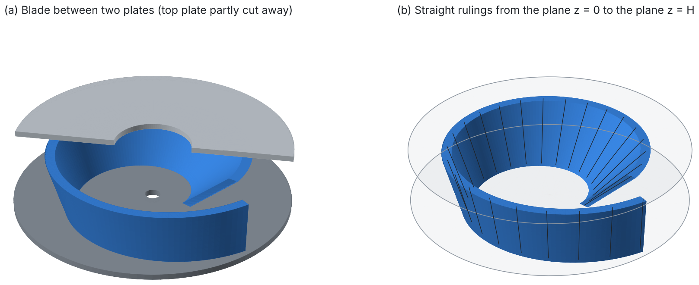
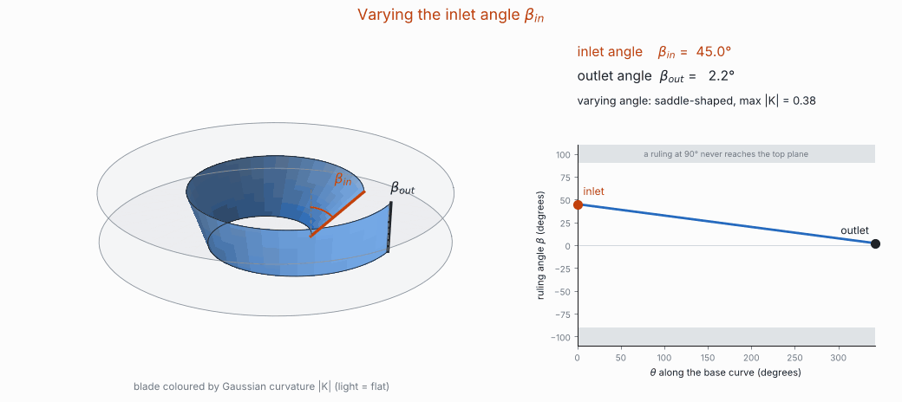
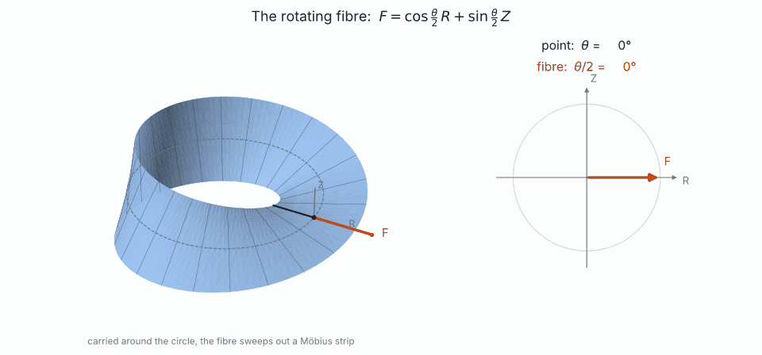
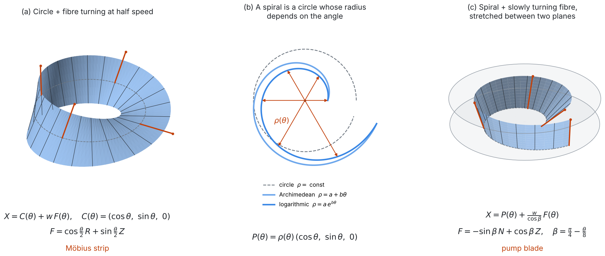
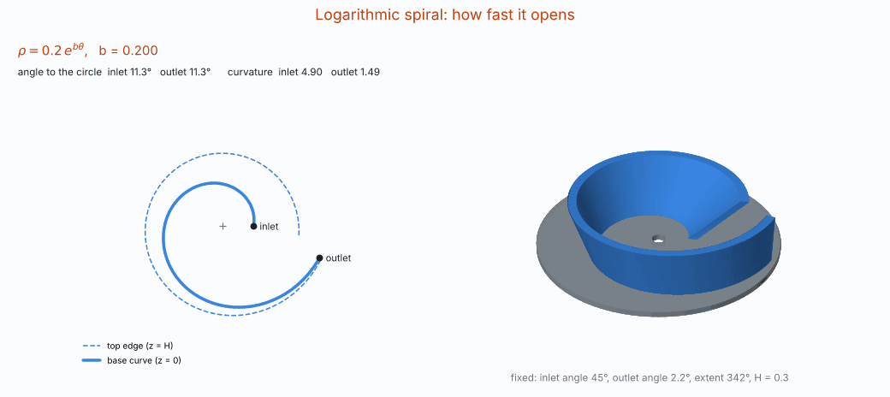
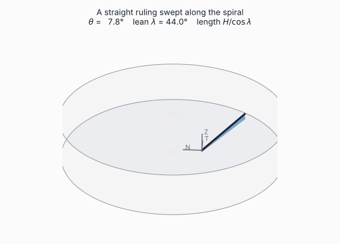
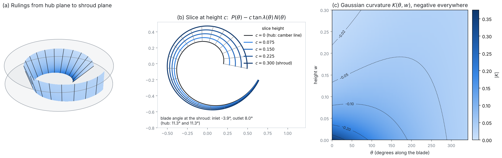

# Single-Channel Pump Model: A Geometric Construction

**Author:** Panagiotis Zavitsanos  
**Status:** geometry complete and verified; no flow analysis yet (see [Limitations](#10-limitations-and-next-steps))

<p align="center">
  
</p>

## Overview

A single-channel pump has one blade that winds around the axis between two parallel plates. This repository builds that blade from a single geometric idea:

1. **A spiral: a circle whose radius depends on the angle.** Any spiral works: logarithmic, Archimedean, or any formula $\rho(\theta)$, winding more tightly or more loosely.
2. **A rotating fibre.** On every point of the spiral stands a straight line, in the plane across the spiral, and it turns about the spiral's tangent as the point moves: from the **inlet angle** $\beta_{in}$ at the start to the **outlet angle** $\beta_{out}$ at the end. It is the same rotating fibre that sweeps out a Möbius strip when it is carried around a circle.
3. **A stretch.** Each fibre is stretched by $1/\cos\beta$ so that it ends exactly on the top plane.

The blade is the surface these fibres sweep out. Everything about it, including its curvature, follows in closed form from the differential geometry of curves and ruled surfaces, for any spiral. In particular, the blade can be rolled from flat sheet **exactly when the inlet and outlet angles are equal**.

<p align="center">
  
</p>

*The two controls of the blade. Left: the blade between the planes, coloured by its Gaussian curvature, with the inlet and outlet rulings and their angles from the vertical. Right: the ruling angle along the blade. When the two angles meet, the curvature vanishes everywhere.*

## Table of contents

1. [Two ingredients: the spiral and the rotating fibre](#1-two-ingredients-the-spiral-and-the-rotating-fibre)
2. [Parameters: seven numbers](#2-parameters-seven-numbers)
3. [The base curve: frame and curvature](#3-the-base-curve-frame-and-curvature)
4. [The blade: straight lines between two planes](#4-the-blade-straight-lines-between-two-planes)
5. [Horizontal slices](#5-horizontal-slices)
6. [Curvature and flat-sheet manufacture](#6-curvature-and-flat-sheet-manufacture)
7. [Wall thickness and CAD export](#7-wall-thickness-and-cad-export)
8. [From the notebooks to this model](#8-from-the-notebooks-to-this-model)
9. [Using the code](#9-using-the-code)
10. [Limitations and next steps](#10-limitations-and-next-steps)

## 1. Two ingredients: the spiral and the rotating fibre

The Möbius strip and the pump blade come from the same formula: a curve in the plane, carrying a straight fibre that turns as the point moves along it,

```math
X(\theta, w) = P(\theta) + w\,F(\theta) .
```

The curve $P$ decides where the fibres stand, and the fibre $F$ decides which way they point. The whole construction comes down to two choices: how the radius grows, and how the fibre turns.

### The spiral: a circle whose radius depends on the angle

A circle of radius $r$ is $r\,(\cos\theta, \sin\theta, 0)$. A spiral is the same circle, with the radius allowed to depend on the angle itself:

```math
\boxed{\,P(\theta) = \rho(\theta)\,(\cos\theta,\ \sin\theta,\ 0)\,}
```

Physically, picture a point going around the axis while it drifts outward. $\rho'(\theta)$ is how fast it drifts per unit of angle, and the **spiral angle** $\psi$, with $\tan\psi = \rho'/\rho$, is how far its path leans away from the circle it would otherwise follow. A circle has $\psi = 0$.

| Radius law | $\rho(\theta)$ | Spiral angle $\psi$ | How the radius grows |
|---|---|---|---|
| circle | $r$ | $0$ | not at all: the point stays at the same radius |
| logarithmic | $a\,e^{b\theta}$ | $\arctan b$, the same everywhere | by the same *factor* per angle: every turn is a scaled copy of the last |
| Archimedean | $a + b\theta$ | $\arctan\dfrac{b}{a + b\theta}$, flattening outward | by the same *amount* per angle: evenly spaced turns, like a rolled carpet |
| any formula | e.g. $0.2 + 0.05\,\theta + 0.01\,\theta^2$ | $\arctan(\rho'/\rho)$ | anything in between |

More spinning or less spinning is one number: a larger $b$ opens the spiral faster, so it needs fewer turns to reach a given radius; a smaller $b$ keeps it closer to a circle.

### The rotating fibre

The Möbius strip of notebook 2 is a circle carrying a fibre that turns as it goes around:

```math
\boxed{\,F(\theta) = \cos\tfrac{\theta}{2}\,R(\theta) + \sin\tfrac{\theta}{2}\,Z, \qquad X(\theta, w) = C(\theta) + w\,F(\theta)\,}
```

Here $C(\theta) = R(\theta) = (\cos\theta, \sin\theta, 0)$ is the circle and its outward radial direction, and $Z$ is the vertical. $F$ always lies in the plane spanned by $R$ and $Z$, the plane across the circle at that point, and it turns inside that plane, about the circle's tangent.

The rate is what gives the strip its character. The fibre turns at **half** the speed of the point. After one full turn around the circle ($\theta = 360^\circ$) it has turned by only $180^\circ$, so it comes back pointing the opposite way: the strip closes up with a half twist, which is the Möbius strip. The fibre needs a second turn ($720^\circ$) to return to where it started. This is the same half-angle that governs spin-½ in physics: a full $360^\circ$ rotation reverses a spinor, and it takes $720^\circ$ to bring it back.

<p align="center">
  
</p>

In general the fibre can stand on any curve and turn at any rate. Measuring its angle $\varphi$ from the outward horizontal direction $\hat R$ across the curve (on a circle, $\hat R = R$):

```math
\boxed{\,F(\theta) = \cos\varphi(\theta)\,\hat R(\theta) + \sin\varphi(\theta)\,Z\,}
```

$d\varphi/d\theta$ is how fast the fibre spins. For the blade it is more convenient to measure the fibre from the vertical, $\beta = \pi/2 - \varphi$, and that is how the inlet and outlet angles are defined in the rest of this document.

### One formula, two objects

| | Base curve $\rho(\theta)$ | Fibre angle from the horizontal, $\varphi$ | From the vertical, $\beta$ | Spin rate $d\varphi/d\theta$ | Fibre length |
|---|---|---|---|---|---|
| Möbius strip (notebook 2) | $1$ (circle) | $\theta/2$ | $\pi/2 - \theta/2$ | $1/2$ | $-1 \le w \le 1$ |
| pump blade (notebook 5) | $0.2\,e^{0.2\theta}$ (spiral) | $\pi/4 + \theta/8$ | $\pi/4 - \theta/8$ | $1/8$ | stretched by $1/\cos\beta$ to span $0 \le z \le H$ |

The blade's fibre starts tilted at $45^\circ$ and spins at a quarter of the Möbius rate, so over its $342^\circ$ it turns by $42.75^\circ$ and finishes nearly upright. The stretch by $1/\cos\beta$ is the one ingredient the Möbius strip does not have: it makes every fibre end exactly on the top plane ([§4](#4-the-blade-straight-lines-between-two-planes)).

<p align="center">
  
</p>

In the code, `fibre()`, `fibre_surface()` and `mobius_strip()` implement these formulas, and the self-check confirms that the general fibre on a circle with $\beta = \pi/2 - \theta/2$ reproduces notebook 2's $\cos\frac{\theta}{2}R + \sin\frac{\theta}{2}Z$ exactly.

## 2. Parameters: seven numbers

| Group | Symbol | Meaning | Notebook design |
|---|---|---|---|
| Base spiral | $a$ | start radius | 0.2 |
| | $b$ | how fast the spiral opens | 0.2 |
| | $\Phi$ | angular extent of the spiral | 342° |
| Inlet and outlet angles | $\beta_{in}$ | angle of the first ruling from the vertical | 45° |
| | $\beta_{out}$ | angle of the last ruling from the vertical | 2.25° |
| Height | $H$ | distance between the two planes | 0.3 |
| Wall | $h$ | blade thickness | 0.05 |

**Count:** 3 (base spiral: 2 shape numbers + extent) + 2 (inlet and outlet angles) + 1 (height) + 1 (thickness) = **7 numbers** define the blade. These are exactly the seven numbers of the final notebook.

Everything else is derived:

| Derived quantity | Where | Notebook design |
|---|---|---|
| radius at inlet and outlet | [§3](#3-the-base-curve-frame-and-curvature) | 0.200 and 0.660 |
| spiral angle of the base curve | [§3](#3-the-base-curve-frame-and-curvature) | 11.3° everywhere |
| curvature of the base curve | [§3](#3-the-base-curve-frame-and-curvature) | 4.90 (inlet) to 1.49 (outlet) |
| spiral angle of the top edge | [§5](#5-horizontal-slices) | −3.9° (inlet), 8.0° (outlet) |
| Gaussian curvature $K(\theta, w)$ | [§6](#6-curvature-and-flat-sheet-manufacture) | −0.376 to −0.010 |
| can be rolled from flat sheet | $\beta_{in} = \beta_{out}$ | no |

Remarks on the count:

- **Only the first group depends on the spiral.** The logarithmic and Archimedean families both have two shape numbers. A spiral given by a formula has as many as its formula has constants, so in general the count is *(shape numbers of the spiral) + 5*.
- **The angle varies linearly** from $\beta_{in}$ to $\beta_{out}$. The notebook's law $\pi/4 - \theta/8$ is exactly this, with $\beta_{in} = 45^\circ$ and $\beta_{out} = 45^\circ - \Phi/8$. Any other smooth law $\beta(\theta)$ fits the same formulas, at the price of more parameters.
- Not counted: the thickness of the plates and the rotation of the whole part about the axis.

## 3. The base curve: frame and curvature

The base curve is the spiral of [§1](#1-two-ingredients-the-spiral-and-the-rotating-fibre), $P(\theta) = \rho(\theta)(\cos\theta, \sin\theta, 0)$ for $0 \le \theta \le \Phi$. Everything below needs only $\rho$, $\rho'$ and $\rho''$, so it holds for every radius law.

With $s = |P'|$ the speed, the unit tangent, the normal and the curvature are

```math
\begin{aligned}
s &= \sqrt{\rho^2 + \rho'^2}, \qquad T = \frac{P'}{s}, \qquad N = Z \times T, \qquad \tan\psi = \frac{\rho'}{\rho},\\
\kappa &= \frac{\alpha'}{s} = \frac{\rho^2 + 2\rho'^2 - \rho\,\rho''}{\left(\rho^2 + \rho'^2\right)^{3/2}},
\qquad \alpha' = \frac{\rho^2 + 2\rho'^2 - \rho\,\rho''}{\rho^2 + \rho'^2},
\end{aligned}
```

where $\alpha'$ is the rate at which the tangent turns. $N$ points toward the inside of the turn. It equals $T'/|T'|$, the derivative of the *unit* tangent, and not the direction of $P''$: the second derivative also depends on how fast the curve is parametrised, while $T'$ records only turning. Because $T \cdot T = 1$, differentiating gives $T \cdot T' = 0$, so $T'$ is automatically perpendicular to the curve.

On a circle these reduce to $s = r$, $\psi = 0$, $\kappa = 1/r$ and $N = -R$, which is why the Möbius fibre and the blade fibre are one formula.

<p align="center">
  
</p>

*Same angles, height and extent, different base curves. First the logarithmic spiral opens faster and slower, then it turns continuously into an Archimedean spiral with the same start and end radius. The blade stays exactly between the two planes throughout.*

## 4. The blade: straight lines between two planes

The fibre of [§1](#1-two-ingredients-the-spiral-and-the-rotating-fibre) stands in the normal plane $\mathrm{span}\lbrace N, Z\rbrace$ of the base curve. Written with its angle $\beta(\theta)$ from the vertical, and with the angle changing linearly from inlet to outlet:

```math
F(\theta) = -\sin\beta\,N + \cos\beta\,Z = R_T(\beta)\,Z, \qquad
\beta(\theta) = \beta_{in} + \bigl(\beta_{out} - \beta_{in}\bigr)\frac{\theta}{\Phi} .
```

$F$ is the vertical direction rotated about the tangent $T$ by $\beta$; with $\hat R = -N$ it is the $\cos\varphi\,\hat R + \sin\varphi\,Z$ of §1, with $\varphi = \pi/2 - \beta$. The blade is the surface swept by the segments in direction $F$, each stretched by $1/\cos\beta$:

```math
X(\theta, w) = P(\theta) + \frac{w}{\cos\beta(\theta)}\,F(\theta) = P(\theta) - w\tan\beta(\theta)\,N(\theta) + w\,Z, \qquad 0 \le w \le H .
```

> **Proposition (two planes).** The height of $X(\theta, w)$ is exactly $w$. Every ruling is a straight segment of length $H/\cos\beta$ from the plane $z = 0$ to the plane $z = H$, for any base curve and any angle law with $-90^\circ < \beta < 90^\circ$.

*Proof.* $P$ and $N$ are horizontal, so the only vertical contribution is $\frac{w}{\cos\beta}\cos\beta = w$. $\square$

What this means in practice:

- **The angles have a direct reading.** $\beta$ is the tilt of the ruling from the vertical, measured across the blade. $\beta = 0$ is a vertical wall; $\beta > 0$ leans the top of the ruling outward, away from the centre of curvature; $\beta < 0$ leans it inward. A ruling at $\pm 90^\circ$ would be horizontal and never reach the top plane, which is the only restriction.
- **The rulings only turn.** Because $F \cdot F = 1$, differentiating gives $F \cdot F' = 0$. Along the blade the direction of a ruling rotates but never stretches, so $1/\cos\beta$ is the only stretch in the construction, and it is there on purpose.
- **The spiral and the angles are independent controls.** The spiral lives in the bottom plane and fixes the footprint of the blade. The angles live in the planes across it and fix how the blade leans.

<p align="center">
  
</p>

## 5. Horizontal slices

The blade is covered by two families of curves: the straight rulings ($\theta$ fixed) and the horizontal slices ($w = c$ fixed). Each slice is an **offset curve** of the base spiral, pushed sideways by $c\tan\beta(\theta)$:

```math
X(\theta, c) = P(\theta) - c\tan\beta(\theta)\,N(\theta) + c\,Z, \qquad
\partial_\theta X = \bigl(s + \alpha' c\tan\beta\bigr)\,T - \frac{c\,\beta'}{\cos^2\beta}\,N .
```

<p align="center">
  
</p>

Two readings of this formula:

- **The top edge has its own spiral angle.** When the angle changes along the blade, the slice picks up the sideways term $-c\beta'/\cos^2\beta$, so the spiral angle at the top differs from the one at the bottom. For the notebook design the top edge has $-3.9^\circ$ at the inlet and $8.0^\circ$ at the outlet, against $11.3^\circ$ along the bottom: at first it runs slightly inward. `slice_spiral_angle()` computes this at any height.
- **Regularity.** For a spiral that keeps turning the same way ($\alpha' > 0$, true for the logarithmic and Archimedean families), leaning outward ($\beta > 0$) is always safe. Leaning inward is safe only while the offset stays below the radius of curvature, $H|\tan\beta| < 1/\kappa$. Beyond that, the slices cross the evolute of the base curve and fold.

## 6. Curvature and flat-sheet manufacture

For a ruled surface $X = P + vF$ the Gaussian curvature is $K = -\det(P', F, F')^2 / |X_\theta \times X_v|^4$. Here $\det(P', F, F') = s\,\beta'$, and in the height coordinate $w$:

```math
\boxed{\,K(\theta, w) = -\,\frac{\bigl(s\,\beta'\bigr)^2}{\Bigl[\bigl(s + \alpha' w\tan\beta\bigr)^2 + \bigl(w\,\beta'/\cos\beta\bigr)^2\Bigr]^2}\,}
\qquad \beta' = \frac{\beta_{out} - \beta_{in}}{\Phi},
```

with $s$ and $\alpha'$ from [§3](#3-the-base-curve-frame-and-curvature). The spiral enters only through these two functions, so the same formula holds for every base curve. What it says:

1. **$K \le 0$ everywhere.** Wherever the blade is curved at all, it is saddle-shaped.
2. **Flat sheet if and only if $\beta_{in} = \beta_{out}$.** $K \equiv 0 \iff \beta' = 0$, whatever the spiral. With equal inlet and outlet angles the blade can be rolled from sheet metal; as soon as they differ, it is doubly curved and has to be cast, pressed, machined or printed.
3. **Along the bottom edge** the curvature is minus the square of how fast the angle turns per unit length: $K\big|_{w=0} = -\left(d\beta/d\sigma\right)^2$, where $\sigma$ is arc length along the spiral.

For the notebook design, $K$ ranges from $-0.376$ at the inlet foot to $-0.010$ at the outlet top. On an Archimedean spiral with $\beta_{in} = \beta_{out} = 30^\circ$, $K = 0$ exactly.

## 7. Wall thickness and CAD export

The blade gets its thickness $h$ by offsetting each horizontal slice by $\pm h/2$ inside its own plane, so both faces stay exactly between the two planes. The original notebook offset along the 3D surface normal instead, which tilts the edges up to $0.018$ past the planes at the $45^\circ$ inlet; `blade_face(..., offset="normal")` reproduces that.

`python scripts/export_cad.py` writes the blade, the bottom plate and the top plate as closed STL solids to [`cad/`](cad/), ready for Autodesk Inventor, Fusion or FreeCAD. The files in the repository are the notebook design; the options below change the spiral and the angles.

## 8. From the notebooks to this model

The construction was developed in Mathematica; the notebooks are kept in [`notebooks/`](notebooks/).

| Step | Notebook | Date | Contribution |
|---|---|---|---|
| 1 | [`01_homotopy_example.nb`](notebooks/01_homotopy_example.nb) | 2025-11-19 | Homotopy $H(s,t) = (1-t)f_0(s) + t f_1(s)$ between two space curves: a family of curves seen as a surface. |
| 2 | [`02_mobius_animations.nb`](notebooks/02_mobius_animations.nb) | 2025-11-22 | Möbius strip as a circle carrying a rotating fibre $F = \cos(\theta/2)R + \sin(\theta/2)Z$: the rotating fibre that the blade inherits. |
| 3 | [`03_log_spiral_v1.nb`](notebooks/03_log_spiral_v1.nb) | 2025-11-24 | Logarithmic spiral and its Frenet frame derived symbolically. First spiral ribbon, with the fibre rotated about the vertical axis. |
| 4 | [`04_modified_mobius_curvature.nb`](notebooks/04_modified_mobius_curvature.nb) | 2025-12-01 | Side study: a warping term $\alpha v^2 \sin u$ that gives the Möbius strip intrinsic curvature. |
| 5 | [`05_log_spiral_v2_final.nb`](notebooks/05_log_spiral_v2_final.nb) | 2026-01-08 | Fibre rotated about the tangent, angle law $\pi/4 - \theta/8$, the $1/\cos$ stretch so rulings span $0 \le z \le 0.3$, wall thickness, and point-cloud export for Inventor ([`data/`](data/)). |

The decisive step between notebooks 3 and 5 was the axis of rotation. Turning the fibre about the vertical axis moves it out of the normal plane of the spiral; turning it about the tangent keeps it there, which is what makes the two-plane property possible.

In the notebooks the normal is called `NormalVec`, because `N` is a protected built-in function in Mathematica, and planar vectors are lifted to 3D with `Append[..., 0]` before they are combined with $Z$.

This repository keeps the construction of notebook 5, lets the base curve be any spiral instead of only the logarithmic one, and adds the closed-form curvature, the flat-sheet condition, the horizontal wall offset and the CAD export.

## 9. Using the code

```bash
pip install -r requirements.txt

python src/blade_geometry.py                    # summary + check against a symbolic derivation
python scripts/export_cad.py                    # STL solids of the notebook design in cad/
python scripts/export_cad.py --spiral archimedean --b 0.0771
python scripts/export_cad.py --spiral "0.2 + 0.05*theta + 0.01*theta**2" --inlet 30 --outlet 10
python scripts/render_hero.py                   # media/hero.png
python scripts/render_fibre.py                  # media/fibre_and_spiral.png
python scripts/make_fibre_animation.py          # media/rotating_fibre.gif
python scripts/render_geometry.py               # media/geometry.png
python scripts/make_angles_animation.py         # media/inlet_outlet_angles.gif
python scripts/make_base_curve_animation.py     # media/base_curves.gif
python scripts/make_ruling_animation.py         # media/ruling_sweep.gif
```

```python
import sys; sys.path.insert(0, "src")
from blade_geometry import Blade, LogSpiral, ArchimedeanSpiral, CustomSpiral, summary

notebook = Blade()                                     # the seven numbers of the notebook
tighter = notebook.with_(spiral=LogSpiral(a=0.2, b=0.15))
archimedean = Blade(spiral=ArchimedeanSpiral(a=0.2, b=0.0771), wrap_deg=342,
                    inlet_angle_deg=30, outlet_angle_deg=30, height=0.3, thickness=0.05)
custom = notebook.with_(spiral=CustomSpiral("0.2 + 0.05*theta + 0.01*theta**2"))

summary(archimedean)   # radii, spiral angles, curvature range; developable: yes
```

Every closed form (curvature of the base curve, height $z = w$, Gaussian curvature) is checked against an independent symbolic computation from the definitions, for a logarithmic, an Archimedean and a custom spiral, and the Möbius fibre of notebook 2 is reproduced from the general one; the errors are below $10^{-14}$.

```
.
├── src/blade_geometry.py      the model: spirals, 7 parameters, closed forms, meshes, STL, symbolic check
├── scripts/                   figures, animations and CAD export
├── cad/                       STL solids of the notebook design
├── media/                     figures and animations used here
├── notebooks/                 original Mathematica notebooks
└── data/                      point cloud exported from notebook 5
```

## 10. Limitations and next steps

- **Flat, parallel plates.** Both ends of every ruling lie on planes. The construction extends naturally to a curved top surface $z = f(r)$: choose each ruling's length so that it ends there instead.
- **Linear angle law.** $\beta$ changes at a constant rate from inlet to outlet. Any smooth law fits the same formulas and could be used to shape where the blade is most curved.
- **No flow analysis.** No CFD has been run, and the pump casing is not modelled. "Pump" describes the intended use of the geometry, not a validated design.

## License

Public domain, under [the Unlicense](LICENSE). Anyone may copy, modify, use and distribute this work for any purpose, without asking permission.
